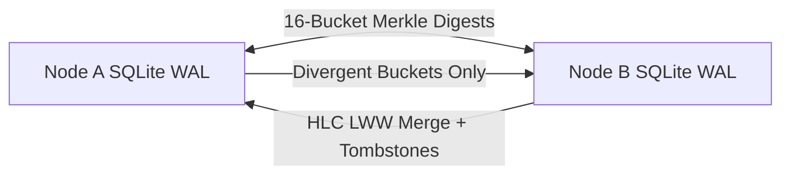

# crdt-sqlite

[](https://github.com/codesphere-u/crdt-sqlite/actions/workflows/ci.yml)
[](LICENSE)
[](pyproject.toml)
[](pyproject.toml)

**Zero-dependency Python Hybrid Logical Clock (HLC), SQLite WAL LWW-Element-Set with tombstones, and 16-bucket Prefix-Merkle anti-entropy sync engine for offline-first distributed apps.**

- **Mission Domain:** Distributed Computing & Local-First Databases
- **Stack:** Pure Python 3.11+ (zero runtime third-party dependencies, `mypy --strict`, `ruff`, `pytest`)
- **Maintainer:** Codesphere Innovations (U) Limited (`codesphere-u`)

---

## Problem Solved

Field tablets, clinics, and edge servers editing shared records offline suffer clock skew, lost updates, and costly full-table re-uploads without lightweight CRDT + Merkle anti-entropy primitives.

## Key Features

- Kulkarni et al. (2014) `HybridLogicalClock` preserving strict monotonic total order even when device wall clocks jump backward.
- SQLite WAL `CrdtSqliteStore` implementing LWW-Element-Set with tombstone preservation and idempotent commutative remote merges.
- 16-bucket SHA-256 Prefix-Merkle anti-entropy digest exchange syncing only divergent key buckets.

## Architecture Overview



See [docs/architecture.md](docs/architecture.md) for module-level design details.

## Installation

```bash
git clone https://github.com/codesphere-u/crdt-sqlite.git
cd crdt-sqlite
uv sync --extra dev
```

Or install in editable mode with standard `pip`:

```bash
pip install -e ".[dev]"
```

## Quick Start (CLI)

```bash
crdt-sqlite demo
```

## Quick Start (Python API)

```python
from crdt_sqlite import CrdtSqliteStore

a, b = CrdtSqliteStore("n1"), CrdtSqliteStore("n2")
a.put("k", {"v": 1}, physical_ms=1000)
b.put("k", {"v": 2}, physical_ms=2000)
a.sync_bidirectional(b)
assert a.get("k") == b.get("k") == {"v": 2}
```

## Testing & Quality Gates

```bash
uv run ruff check src tests
uv run mypy src
uv run pytest -v
```

## Security, Contributing & Roadmap

- **Security:** See [SECURITY.md](SECURITY.md) for responsible disclosure procedures.
- **Contributing:** See [CONTRIBUTING.md](CONTRIBUTING.md) and [CODE_OF_CONDUCT.md](CODE_OF_CONDUCT.md).
- **Changelog & Roadmap:** See [CHANGELOG.md](CHANGELOG.md) and [ROADMAP.md](ROADMAP.md).

## License

MIT License — see [LICENSE](LICENSE).

## Support & Contact

Open an issue on [GitHub Issues](https://github.com/codesphere-u/crdt-sqlite/issues) or contact `codesphereinnovationz@gmail.com`.
